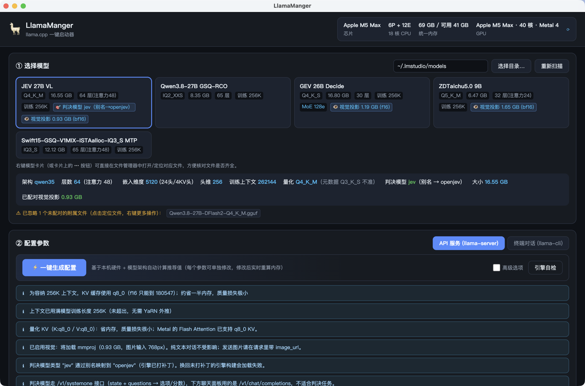

# LlamaManger 🦙

llama.cpp 一键启动器（Electron 桌面应用）。

选一个 `.gguf` 模型 → 点 **⚡ 一键生成配置** → 应用根据你的**本机硬件**（Apple Silicon / 内存 / GPU）和**模型架构**（GGUF 元数据：层数、KV 头数、训练上下文、MoE 专家数…）自动算出一整套合理参数 → 直接启动 **llama-server（API 服务，带内嵌流式聊天）** 或 **llama-cli（系统终端对话）**。



## 功能

| 功能 | 说明 |
|---|---|
| 硬件检测 | macOS：`sysctl`/`system_profiler`/`vm_stat`（芯片、P/E 核、Metal、可用内存）；Windows：PowerShell CIM + 注册表 `qwMemorySize`（**显存**、物理核）；Linux：`/proc` + `lscpu` + `nvidia-smi`/`rocm-smi` |
| 显存感知推荐 | **PC（独立显卡）按「显存 + 内存」两笔账**规划：全量卸载 → KV 回内存 → MoE 专家留内存 → 部分卸载，并给出各自的余量；显存读不到时明确警告并交回引擎（ngl=auto） |
| 模型扫描 | 目录递归找 `.gguf`，自研 GGUF v3 头解析（流式读，大文件不吃内存） |
| 文件角色识别 | 读 `general.type` + 架构判定：**主模型 / mmproj 视觉投影 / 草稿(draft) 模型**。附属文件不再冒充独立模型，而是挂到同目录主模型上（👁 视觉投影 / ⚡ 草稿），选主模型时自动配对好 `-mm` / `-md` |
| 量化实测 | 读 **tensor 表**按元素数加权推导真实量化（发布者的 `general.file_type` 经常写错，如 BF16 的 mmproj 标成 IQ3_S）；元数据不一致时界面标注"元数据 X 不准" |
| 一键配置 | 内存模型估算（权重 + 附属文件 + KV + 计算缓冲）→ 推荐 ngl / ctx / KV 精度 / MoE 专家卸载 / 线程 / 采样 |
| 参数说明 | 每个参数中文说明（hover 提示）+ 关联说明（控件下方小字） |
| 关联提示 | 上下文>训练长度→YaRN 警告；超内存→红色提示+一键修复（降 ctx / q8_0 KV / 增专家卸载）；并行→KV×N 提示；线程超 P 核提示；**内置 MTP → 一键开启 `--spec-type draft-mtp`**；草稿模型类型不匹配→提示纠正；**decision 模型类型不受引擎支持→红色预警** |
| 换算工具 | 当前 ctx ↔ KV 占用 GB；内存预算 → 最大可容纳上下文（实时）。KV 口径按「真实带 KV 的层 × 每层 KV 头 × 头维」逐层累加，与引擎日志一致（256K q8_0 = 8704 MiB） |
| 内存面板 | 堆叠条：GPU 权重 / 内存池权重 / KV / 计算 / 空闲（附属文件单列），修改参数实时重算 |
| 视觉 / 加速 | `-mm` 视觉投影（默认 GPU 卸载）、`-md` 草稿模型 + `--spec-type`；**投机解码下拉框按当前模型能力过滤**：只有内置 MTP 或配套草稿模型时才列出 draft-*，ngram-* 恒可用，不可用项隐藏并在旁注明原因；**草稿有专用实现（dflash/eagle3/dspark）时禁用通用 `draft-simple` 并自动纠正已有取值**（选错会静默变慢，见「投机解码」节的实测表）；`--spec-draft-n-max` 可在高级选项里调，附实测拐点说明 |
| 启动 | server：进程托管 + 日志流 + 就绪检测 + 优雅停止；cli：生成脚本在 Terminal.app 打开（真实 TTY） |
| 内嵌聊天 | OpenAI 兼容 `/v1/chat/completions` 流式对话，支持 API Key、中止、多轮；推理模型的思考内容以 💭 斜体单独展示；**请求固定 `id_slot`**，使这段上下文留在该 slot 里可被存盘 |
| 会话存盘 | `--slot-save-path` + `/slots/{id}?action=save\|restore\|erase`：把一段长会话（提示词缓存 + KV）整体存成磁盘文件，之后**秒级恢复、无需重新 prefill**。反复用同一份长文档（报告/代码库/合同）时最省时间；面板内可直接列出/恢复/删除存盘文件 |
| 文件定位（右键） | **右键**模型卡片、卡片上的 👁/⚡ 附属标签、未配对文件标签或存盘文件 → 「在文件夹中显示（高亮文件）/ 打开所在文件夹 / 复制完整路径」；卡片右上角 `⋯` 是等价入口。核对"文件是不是齐了、路径对不对"时不用再去 Finder/资源管理器里翻目录 |
| 引擎自检 | 调用 `llama-fit-params` 做引擎侧交叉验证（信息性输出） |
| 端口检测 | 启动前检测占用，自动建议空闲端口 |

## 快速开始

```bash
npm install
npm start
```

1. 在 **① 选择模型** 填入模型目录（默认 `~/models`），点「重新扫描」。
2. 点击模型卡片 → 点 **⚡ 一键生成配置**（右侧内存条与命令预览实时更新）。
3. **③ 启动引擎** → 「启动」。server 模式就绪后可直接在下方对话框聊天；cli 模式会在系统终端打开。

> 想核对磁盘上的文件（是否缺 mmproj、量化对不对）：**右键模型卡片** → 「在文件夹中显示」，直接在文件管理器里高亮该 `.gguf`。

### 依赖的引擎

本应用**不含 llama.cpp 二进制**，用你本地已有的构建产物（默认探测 `~/llama.cpp/build`、`~/Documents/GitHub/llama.cpp/build`，也可在「llama.cpp build 目录」输入框指定）：

```bash
./scripts/build-engine.sh                        # 自动探测仓库位置
./scripts/build-engine.sh /path/to/llama.cpp     # 或显式指定
LLAMA_CPP_DIR=/path/to/llama.cpp ./scripts/build-engine.sh
# = cmake（LLAMA_BUILD_SERVER=ON, LLAMA_BUILD_UI=ON）+ ninja → llama-cli / llama-server / llama-fit-params / llama-bench
```

需要 `cmake` 与 `ninja`（macOS：`brew install cmake ninja`）。若你的 cmake/ninja 装在非默认位置（例如某个 venv 里），用 `LLAMA_CMAKE_BIN=<目录>` 指给脚本：

```bash
LLAMA_CMAKE_BIN=~/.venv/bin ./scripts/build-engine.sh ~/llama.cpp
```

Windows 用 PowerShell 脚本（同样需要 `cmake` / `ninja` 在 PATH 中）：

```powershell
.\scripts\build-engine.ps1
```

### 判决(decision)模型兼容补丁（可选）

部分第三方导出的判决模型把 `*.decision.type` 写成 `jev`，而引擎类型表里只有 `openjev`（两者的 `systemone` 模板与 `temperature/verbalizer_ids/bias.{noul,score,choice}` 元数据结构完全一致），不打补丁会在加载阶段直接退出：

```
failed to init decision model: unsupported decision model type: jev
```

```bash
./scripts/patch-engine.sh status   # 查看是否已应用（自动探测仓库路径）
./scripts/patch-engine.sh apply    # 打补丁（幂等，可重复执行）
./scripts/patch-engine.sh revert   # 回退
# 打完补丁后重建引擎：
cmake --build ~/Documents/GitHub/llama.cpp/build --target llama-server llama-cli -j 10
```

应用会把这类模型标成「🎯 判决模型 jev（别名→openjev）」，并在提示区说明它走 `/v1/systemone` 而不是聊天接口。

## 测试

```bash
npm test
```

`node:test` 单元测试（不依赖 Electron，当前 **373 项全绿**）：

- `test/gguf.test.js` — 合成 GGUF v3 文件（`test/helpers.js` 生成器）→ 解析器
- `test/recommend.test.js` — 一键推荐：ctx 选择、MoE 卸载、q8_0 降级、YaRN 提示
- `test/recommend-discrete.test.js` — PC 双预算规划（9 种显存/内存组合 + 规划器与内存面板口径一致性不变量）
- `test/memory.test.js` — 内存模型：ngl 比例、KV 精度/并行缩放、超限判定
- `test/kv-geometry.test.js` — KV「哪些层、每层多大」：混合 SSM 的 recurrent 语义、MTP 层排除、`full_attention_interval` 兜底、gemma4 逐层 KV 头与 SWA 头维（含与引擎日志对齐的 8704 MiB 校验）
- `test/args.test.js` — CLI 参数映射（对照 llama.cpp 源码核对过标志名；含已删除的 `--mlock/--mmap/-dio` 不再下发、`--tools read_only` 展开）
- `test/migrate.test.js` — 旧参数迁移：`--mmap/--mlock/-dio` → `--load-mode`（含 `loadMode:'auto'` 不吞掉旧字段）
- `test/role.test.js` — 文件角色 / 量化实测 / decision 类型 / 附属文件归组
- `test/spec.test.js` — 投机解码类型与模型能力的匹配矩阵
- `test/agent.test.js` — Agent 工具分类、`--tools` 展开（过滤引擎不认识的名字）、tool_calls 状态机
- `test/slots.test.js` — 会话存盘的磁盘操作（文件名校验 / 列目录 / 删除 / 防路径穿越）
- `test/sessions.test.js` — 会话存档 JSONL 读写与导出
- `test/anthropic.test.js` — Anthropic Messages ↔ OpenAI Chat 适配层
- `test/multimodal.test.js` — 图片 MIME 识别与多模态消息构造
- `test/bench.test.js` — llama-bench JSON 解析与 TTFT/吞吐提取
- `test/hf.test.js` — HuggingFace 模型列表与下载
- `test/sandbox.test.js` — 子进程沙箱能力探测与启用判定
- `test/hardware.test.js` — 跨平台硬件解析（nvidia-smi / 注册表显存 / WMI 溢出兜底 / lscpu / 多卡取最大）
- `test/engine.test.js` — 引擎二进制候选与终端启动命令（`.exe`、`launch.cmd` 转义、各平台终端链）
- `test/reveal.test.js` — 「在文件夹中显示」的目标解析（文件高亮 / 目录直接打开 / 文件已消失时报错）
- `test/paths.test.js` — 渲染层路径工具（Windows 反斜杠路径的取目录 / 拼路径）

## 目录结构

```
main/            主进程
  main.js        窗口 + IPC 路由（含 fs:reveal 文件定位、clipboard:write）
  hardware.js    硬件扫描（macOS/Linux/Windows）
  gguf.js        GGUF v3 流式解析
  models.js      模型目录扫描
  recommend.js   一键推荐（纯函数，可单测）
  reveal.js      「在文件夹中显示」目标解析（纯函数）
  config.js      settings.json 持久化
  engine.js      server 进程管理 / 终端启动 / 端口探测 / fit 自检
shared/args.js   CLI 参数映射（唯一来源）
preload.js       contextBridge（lm.* API）
renderer/
  index.html     三区布局：模型 / 配置+内存 / 启动+聊天
  app.js         UI 逻辑（提示规则、换算、聊天流、右键菜单接线）
  ctxmenu.js     通用右键菜单组件
  paths.js       路径字符串工具（兼容 Windows 反斜杠，纯函数）
  i18n.js        参数元数据中心（中文说明/关联说明）
  styles.css     深色主题
test/            node:test 单元测试 + GGUF 夹具生成器
  role.test.js   文件角色识别 / tensor 实测量化 / decision 类型 / 附属文件归组
  spec.test.js   投机解码类型与模型能力的匹配矩阵
  slots.test.js  会话存盘的磁盘操作（文件名校验 / 列目录 / 删除 / 防路径穿越）
  kv-geometry.test.js  KV 层数与几何（混合 SSM / MTP / SWA）
  reveal.test.js 文件定位目标解析（高亮 / 打开目录 / 缺失报错）
  paths.test.js  路径工具（Windows 反斜杠）
scripts/build-engine.sh  引擎重建脚本（macOS / Linux）
scripts/build-engine.ps1 引擎重建脚本（Windows / PowerShell）
scripts/patch-engine.sh  decision 类型别名补丁（apply / revert / status）
scripts/patches/         补丁文件
e2e/             CDP 端到端脚本（`node e2e/cdp-eval.js <步骤脚本>`，需应用带 --remote-debugging-port 启动；
                 目录/存盘路径用 LM_MODELS_DIR / LM_SLOTS_DIR 环境变量传入，见 e2e/README.md）
```

## 内存模型（一键配置的算法核心）

```
KV 字节/ token = Σ_注意力层( KV头数 × K头维 ) × K精度字节 + Σ_注意力层( KV头数 × V头维 ) × V精度字节
总占用 = 主模型 + mmproj + 草稿模型 + KV × 上下文 × 并行数 + 计算缓冲(≈1.5GB + 0.5GB×batch/2048)
可用内存 = 总内存 − max(8GB, 20%×总内存)
```

- **哪些层真的有 KV**（这一步最容易错，错了就是几倍误差）：
  1. 排除 MTP/nextn 层（`nextn_predict_layers`）—— 引擎给它们单独建上下文；
  2. 混合 SSM/注意力架构（`qwen35` 等）只有**非 recurrent** 层存 KV：`attention.recurrent_layers[i] = true` 表示该层是 SSM 层（**要数 false 的个数**，数 true 会得到 SSM 层数，直接错 3 倍）；
  3. 没有 `recurrent_layers` 时用 `full_attention_interval` 推（每 N 层一个全注意力层）。
- **每层的 KV 头数与头维可能逐层不同**（gemma4 滑动窗口：`attention.head_count_kv` 是数组，SWA 层用 `key_length_swa`），逐层累加而不是拿最大值乘层数。
- 实测校验：Swift-1.5-Qwen3.8-27B（65 层 / 16 个注意力层 / 4 KV 头 / 头维 256）在 256K 上下文下 **q8_0 KV = 8704 MiB**，与 `llama-server -v` 日志的 `llama_kv_cache: size = 8704.00 MiB (262144 cells, 16 layers, ...)` 完全一致（f16 则 17.18GB）。
- **头维**优先取 `attention.key_length`：混合架构下 `embedding_length/head_count` 会失真（213 vs 实际 256）。
- **上下文优先拉满到模型训练长度**：从训练长度向下找可容纳档位（档位 4K…256K，上限跟随 `context_length`），装不下再降 KV 精度（只自动用 f16 → q8_0；q4_0 质量损失可感，只在连最小档都装不下时兜底，其余情况仅作为「理论上可到 X」的提示）。
- **附属文件计入预算**：mmproj / 草稿模型的大小会从内存预算里先扣掉，再决定上下文档位。
- **投机解码按能力给默认值**：模型自带 MTP 层 → `draft-mtp`；配了草稿模型 → 按其架构（dflash/eagle3/dspark/simple）；都没有 → `none`。草稿架构有专用实现时（dflash/eagle3/dspark），通用 `draft-simple` 会被**禁用并自动纠正**（见下节实测）。
- MoE：文件较大（> 0.6×可用内存）时把全部专家层留在内存池（`-ncmoe N`，GPU 只留 ~15% 权重）——统一内存下专家权重计算强度低，走内存几乎不损失速度。
- Apple Silicon 统一内存 → `ngl=all`（全量 Metal 卸载）；线程 = P 核数，批处理线程 = 总核数。
- 上下文 > 训练长度 → 提示 YaRN（预填 `--yarn-orig-ctx`，不自动开启）。

## GGUF 解析要点（踩过的坑）

| 项 | 正确做法 |
|---|---|
| 版本头 | `magic 'GGUF'` + **u32** version + i64 tensor_count + i64 kv_count |
| 字符串 | **u64** 长度前缀（键名与字符串值都是） |
| 类型枚举 | 8=string、**9=array**、**10=u64**、11=i64、12=f64；bool 占 **1 字节**（旧资料里 9=u64 / 12=array 已过时） |
| array | `i32 元素类型` + `u64 元素个数` + 元素序列（`tokenizer.ggml.tokens` 可到 25 万项） |
| 量化 | 读 **tensor 表**按元素数加权统计（跳过 1 维张量）→ 发布者的 `general.file_type` 常年不准 |
| 角色 | `general.type=mmproj` / `arch=clip` → 视觉投影；`arch=dflash/eagle3/dspark` → 草稿模型；其余为主模型 |
| 判决模型 | `*.decision.type`（如 `jev`）必须是引擎支持的取值，否则 llama-server 直接退出 |

## 投机解码：实测数据与「选错类型」的代价

草稿模型的架构决定了 `--spec-type` 该选什么，**选错不会报错，只会变慢**。同一台机器（Apple M5 Max / 68GB）、同一个提示词、`temperature=0`、256K 上下文 q8_0 KV、`n_predict=192`，两轮复测结果一致：

| `--spec-type` | 生成速度 | 草稿接受率 | 平均接受长度 |
|---|---|---|---|
| `none`（不开加速） | 32.4 tok/s | — | — |
| `draft-simple` + DFlash2 草稿 | **16.2 tok/s** | **0.4%**（1/283） | 1.01 |
| `draft-dflash` + DFlash2 草稿 | 44.9 tok/s | 51.6% | 2.53 |
| `draft-dflash` + `--spec-draft-n-max 8` | 52.4 tok/s | 31.8% | 3.18 |
| `draft-mtp`（模型自带 MTP 头） | 52.2 tok/s | 68.4% | 3.03 |
| `draft-mtp` + `--spec-draft-n-max 8` | 38.8 tok/s | 39.9% | 4.06 |
| `draft-mtp` + `--spec-draft-n-max 16` | 19.0 tok/s | 22.0% | 4.24 |

结论：

- **DFlash2 是 `dflash` 架构**（专用实现，靠块扩散一次并行出 8 个块的 token）。用通用 `draft-simple` 跑，它的机制完全用不上 → 草稿几乎全被拒（0.4%），你白付了草稿模型的计算和显存，**比不开加速还慢一倍**。
- **模型自带 MTP 时通常最划算**：不用额外加载草稿模型、接受率最高。这里 `draft-mtp` 52 tok/s 略快于 `draft-dflash` 45 tok/s（把后者的 `n-max` 调到 8 可追平）。
- **`--spec-draft-n-max` 调大不等于更快**：接受率反而下降、验证开销上升，两种类型的拐点还不一样（dflash 3→8 变快，mtp 3→8→16 明显变慢）。所以默认值只在显式改过时才下发，参数说明里附了实测数字。

### `--spec-draft-n-max` 该设多少（`draft-mtp` 扫描）

同一模型（Swift-1.5-Qwen3.8-27B 自带 MTP）、同一提示词、`temperature=0`、192 token 生成。接受率与平均接受长度是**确定性**的（只由文本和参数决定），tok/s 有 ±10% 的机器抖动：

| `n-max` | 短上下文（42 token 提示词） | 长上下文（2859 token 提示词） | 接受率（短 / 长） | 平均接受长度（短 / 长） |
|---|---|---|---|---|
| 1 | 39.6 tok/s | — | 85.4% / — | 1.85 / — |
| 2 | 47.9 | — | 74.5% / — | 2.48 / — |
| 3（默认） | 55.1 | 45.4 | 68.4% / 73.2% | 3.03 / 3.18 |
| 4 | 56.5 | 51.1 | 58.3% / 67.4% | 3.29 / 3.70 |
| 5 | **57.0** | 51~56 | 50.6% / 61.0% | 3.47 / 4.05 |
| 6 | 56.0 | **57~59.5** | 44.7% / 57.2% | 3.60 / 4.42 |
| 7 | 43.6 | 56.7 | 40.5% / 50.8% | 3.79 / 4.54 |
| 8 | 39.5 | 41.2 | 38.8% / 47.3% | 3.98 / 4.79 |
| 12 | — | 36.3 | — / 35.4% | — / 5.13 |
| 16 | — | 20.6 | — / 28.8% | — / 5.48 |

- **默认 3 不是最优，但也不是坑**：最佳区间是 5±2，且**随上下文变长向右移**（短上下文峰值在 4~5，长上下文峰值在 6~7）。
- **改 4 或 5 的收益**：短上下文只有 +2~4%（55.1 → 56.5~57.0）；**长上下文 +12~30%**（45.4 → 51~59.5）—— 因为长上下文下每步的固定开销（长 KV 注意力、采样）被更多被接受的 token 摊薄了。
- **8 是分界线，12/16 是灾难**（-30% ~ -60%）：接受率单调下降、验证开销单调上升，两者交叉后就一路下滑。
- **别用单次 tok/s 调参**：机器负载带来的抖动和你想调的那点收益同量级。看日志里确定性的 `draft acceptance = … (… accepted / … generated), mean len = …` 更可靠。

结论：**长会话/长文档用 `--spec-draft-n-max 5`（稳妥）或 `6`（长上下文最快），不要超过 8。**

因此应用做了两层防护：**草稿架构有专用实现时下拉框不再提供 `draft-simple`**（并在原因里写明正确取值）；**已有的错误取值在选择模型时自动纠正**，弹出提示说明原因（`settings.json` 里存的是旧值也会被改过来）。

## 会话存盘（反复用同一份长文档）

llama.cpp 的 KV 缓存只能待在内存里（**磁盘无法扩展上下文长度**），但可以**把一段已经算好的上下文存到磁盘、随时恢复**：

1. 「② 配置参数 → 高级选项 → 会话存盘目录」填一个目录（如 `~/llama-slots`），**重启服务**生效。
2. 在「③ 启动引擎 → 会话存盘」面板里：对话固定使用 `会话 slot 0`，故这段上下文会保留在内存中。
3. 喂完长文档后点 **保存到磁盘** → 生成 `xxx.bin`（体积 ≈ 该 slot 的 KV 大小）。
4. 之后随时 **从磁盘恢复**，再提问就直接复用，跳过几万 token 的 prefill（实测 187 tokens 的会话：存盘 66ms / 恢复 23ms / 后续请求复用约 50%）。

要点：请求必须带 `id_slot`（应用已自动带上），否则服务端会在请求结束后释放 slot，存下来的是空状态。
命令行等价用法：

```bash
llama-server -m model.gguf --slot-save-path ~/llama-slots ...
curl -X POST 'http://127.0.0.1:9931/slots/0?action=save'    -H 'Content-Type: application/json' -d '{"filename":"doc.bin"}'
curl -X POST 'http://127.0.0.1:9931/slots/0?action=restore' -H 'Content-Type: application/json' -d '{"filename":"doc.bin"}'
```

## 跨平台支持（macOS / Windows / Linux）

| 能力 | macOS | Windows | Linux |
|---|---|---|---|
| 应用外壳 / UI / 解析 / 参数生成 | ✅ | ✅ | ✅ |
| 引擎二进制探测 | ✅ `build/bin` | ✅ `build\bin\Release`（MSVC）与 `build\bin`，自动加 `.exe` | ✅ `build/bin` |
| 硬件检测 | ✅ 统一内存（无独立显存） | ✅ 显存走注册表 `qwMemorySize`（WMI 的 AdapterRAM 大于 4GB 会溢出，仅作兜底） | ✅ `nvidia-smi` / `rocm-smi` |
| 一键配置内存模型 | 统一内存单笔账 | **显存 + 内存两笔账**，自动决定 ngl / KV 放哪边 / MoE 专家留内存 | 同 Windows |
| CLI 模式开终端 | ✅ Terminal.app | ✅ 生成 `launch.cmd`（UTF-8 代码页），`cmd /c start` 打开新窗口 | ✅ 链式探测 `x-terminal-emulator`/`gnome-terminal`/`konsole`/`xfce4-terminal`/`alacritty`/`xterm` |
| 会话存盘 | ✅ | ✅ | ✅ |
| 右键「在文件夹中显示」 | ✅ Finder 高亮文件（已实测） | ✅ 资源管理器 `/select`（同 Electron `shell.showItemInFolder`） | ✅ 由桌面环境决定是否高亮，至少会打开目录 |
| 打包 | `npm run pack:mac` | `npm run pack:win`（NSIS + 便携版） | `npm run pack:linux`（AppImage） |

Windows 构建引擎：

```powershell
.\scripts\build-engine.ps1                 # 默认 ~\llama.cpp
.\scripts\build-engine.ps1 -Repo D:\llama.cpp -Clean
```

平台相关逻辑（显存解析、二进制候选、脚本与命令行生成、双预算规划）**全部是可注入的纯函数并已单测覆盖**（`test/hardware.test.js`、`test/engine.test.js`、`test/recommend-discrete.test.js`），可在任意平台验证。

## 安全

- `contextIsolation: true`，渲染层无 Node 权限；所有系统操作走 IPC 白名单。
- server 默认只监听 `127.0.0.1`。

## 已知限制

- **Windows 尚未在真机验证**：显存检测（注册表 `qwMemorySize`）与 `launch.cmd` 启动路径的代码已完成并有单测，但要在真实 PC 上跑一遍才能确认；若显存读不到，应用会显示「未能检测到显卡显存」并把 `ngl` 交给引擎。
- KV 精度字节数为块量化近似值（q8_0≈1.03B 等），估算误差 < 3%。
- **文件定位的 Windows/Linux 表现尚未真机验证**（macOS 已实测：Finder 高亮文件 + 打开目录）：走的是 Electron `shell.showItemInFolder` / `shell.openPath`，路径解析逻辑已单测（`test/reveal.test.js`、`test/paths.test.js`）。
- 引擎为私有 fork（带 decision 模型支持）时，模型元数据里的 `*.decision.type` 必须在该构建的类型表内，应用只能预警、无法绕过。
